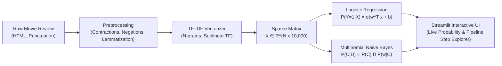

# 🎬 Sentiment Analysis on Movie Reviews (Phân tích Cảm xúc Đánh giá Phim)
### An End-to-End NLP & Text Classification Project for Introduction to AI (Nhập môn Trí tuệ Nhân tạo)

---

## 📌 Project Overview / Tổng quan Dự án

Text classification is the cornerstone of Natural Language Processing (NLP). This project serves as an educational and mathematical bridge connecting unstructured human language with classical machine learning algorithms.

Using the benchmark **IMDb 50,000 Movie Reviews Dataset**, this repository implements a complete pipeline:
1. **Raw Text Cleaning & Normalization** (Noise removal, negation-aware stopwords, and lemmatization via NLTK).
2. **Feature Extraction** (Vector Space Modeling via TF-IDF n-grams).
3. **Statistical Modeling & Classification** (Logistic Regression & Multinomial Naive Bayes).
4. **Interactive Web Application** (Streamlit app with live inference, step-by-step mathematical inspection, and model benchmarks).
5. **Advanced Extension** (Zero-Shot LLM prompting comparison vs classical ML).

---

## 🏛️ Project Architecture / Kiến trúc Dự án

| Thành phần (Component) | Công nghệ (Tech Stack) | Mục đích (Purpose) |
|---|---|---|
| **Data Manipulation** | `pandas`, `numpy` | Xử lý dữ liệu bảng, ma trận và vector hóa |
| **Text Preprocessing** | `nltk`, `re` | Xóa thẻ HTML, giữ từ phủ định, Lemmatization từ gốc |
| **Vectorization** | `scikit-learn` (`TfidfVectorizer`) | Chuyển đổi văn bản thành ma trận thưa (Sparse Matrix) |
| **Classification Models** | `scikit-learn` (`LogisticRegression`, `MultinomialNB`) | Phân loại phân biệt (Discriminative) và sinh mẫu (Generative) |
| **Model Persistence** | `joblib` | Lưu trữ vectorizer và trọng số mô hình đã huấn luyện |
| **Interactive UI** | `streamlit`, `altair` | Web app trực quan hóa quy trình toán học theo thời gian thực |
| **Advanced LLM** | `urllib` / Prompt Engineering | So sánh suy luận Zero-Shot với mô hình truyền thống |

---

## 🗂️ Directory Structure / Cấu trúc Thư mục

```plaintext
Project Text Classification/
├── data/
│   ├── IMDB Dataset.csv              # File dữ liệu 50.000 đánh giá phim
│   └── cleaned_imdb_dataset.csv      # Dữ liệu đã làm sạch & Lemmatization (cached)
├── models/
│   ├── tfidf_vectorizer.joblib       # Trọng số TF-IDF Vectorizer
│   ├── logistic_regression.joblib    # Mô hình Logistic Regression
│   ├── naive_bayes.joblib            # Mô hình Multinomial Naive Bayes
│   ├── metrics.json                  # Chỉ số đánh giá (Accuracy, F1, Matrix)
│   └── top_features.json             # Top từ khóa tích cực/tiêu cực nhất
├── src/
│   ├── __init__.py
│   ├── preprocess.py                 # Pipeline tiền xử lý NLP & giải thích từng bước
│   ├── train.py                      # Huấn luyện mô hình, tính toán ma trận nhầm lẫn
│   └── llm_analyzer.py               # Module so sánh suy luận Zero-Shot bằng LLM
├── app.py                            # Streamlit Web App tương tác cao cấp
├── clean_data.py                     # Script nạp dữ liệu và kiểm thử cơ bản
├── requirements.txt                  # Các thư viện phụ thuộc
└── README.md                         # Tài liệu hướng dẫn chi tiết
```

---

## 🔬 Implementation Pipeline / Quy trình Triển khai



### 1. Data Preprocessing (Tiền xử lý Dữ liệu)
* **HTML & Contraction Cleaning**: Xóa thẻ `<br />`, chuyển `won't` $\rightarrow$ `will not`, `can't` $\rightarrow$ `can not`.
* **Preserving Negations (Bảo toàn Từ phủ định)**: Trong phân tích cảm xúc, từ phủ định (`not`, `never`, `nor`) quyết định hoàn toàn dấu của cảm xúc. Do đó, các từ này được giữ lại thay vì xóa như stopword thông thường.
* **Lemmatization**: Sử dụng `WordNetLemmatizer` với cơ chế cache bộ nhớ để đưa các biến thể từ (`running` $\rightarrow$ `run`, `movies` $\rightarrow$ `movie`) về từ gốc từ điển.

### 2. Feature Extraction (Trích xuất Đặc trưng TF-IDF)
Chuyển đổi văn bản thành ma trận không gian vector (Vector Space Model):
$$\text{TF-IDF}(t, d, D) = \text{TF}(t, d) \times \left( \log\frac{1 + |D|}{1 + |\{d \in D : t \in d\}|} + 1 \right)$$
* Cấu hình n-gram `(1, 2)` giúp mô hình học được cả từ đơn và cụm từ ngữ cảnh như `"not good"`, `"masterpiece"`, `"waste time"`.

### 3. Model Training & Evaluation (Huấn luyện & Đánh giá)
* **Logistic Regression**: Tối ưu hóa siêu phẳng phân tách với hàm kích hoạt Sigmoid:
$$z = \sum_{i=1}^V w_i x_i + b \quad \longrightarrow \quad P(\text{Positive}|\mathbf{x}) = \frac{1}{1 + e^{-z}}$$
* **Multinomial Naive Bayes**: Áp dụng định lý Bayes với làm mượt Laplace ($\alpha = 1$):
$$P(C|D) \propto P(C) \prod_{i=1}^n P(w_i|C)$$

---

## 🚀 Quickstart Guide / Hướng dẫn Chạy

### 1. Di chuyển vào thư mục dự án và cài đặt thư viện
Mở Terminal và trỏ vào thư mục dự án:
```bash
cd ProjectTextClassification
pip install -r requirements.txt
```

### 2. Huấn luyện mô hình (Training Baseline)
```bash
python src/train.py
```
*Script sẽ tự động đọc dữ liệu, tiền xử lý, huấn luyện cả 2 mô hình (Logistic Regression & Naive Bayes) và lưu trọng số vào thư mục `models/`.*

### 3. Khởi chạy Giao diện Trực quan (Streamlit Web App)
```bash
streamlit run app.py
```
Truy cập trình duyệt tại: `http://localhost:8501`

---

## 🌟 Streamlit Web App Highlights

1. **Live Sentiment Inference**: Nhập bất kỳ review phim nào hoặc chọn preset mẫu; xem dự đoán tức thì cùng thanh đo xác suất trực quan.
2. **Interactive Mathematical Pipeline Explorer**: Khám phá từng bước biến đổi dữ liệu:
   - Từ văn bản thô $\rightarrow$ văn bản làm sạch.
   - Thống kê tỷ lệ loại bỏ nhiễu stopword.
   - Bảng trọng số vector TF-IDF được kích hoạt cho riêng review đó.
   - Công thức tính toán tổng đóng góp trọng số $w_i \times x_i$ và hàm Sigmoid.
3. **Model Benchmark & Confusion Matrix**: So sánh trực quan độ chính xác, F1-Score, ma trận nhầm lẫn và biểu đồ top 15 từ khóa tích cực / tiêu cực nhất.
4. **Educational Theory Bridge**: Trình bày toán học trực quan về Vector Space Model, ma trận thưa (Sparsity > 99%), công thức TF-IDF và thuật toán phân loại.
5. **Advanced Extension (LLM Comparison)**: So sánh trực quan giữa mô hình học máy truyền thống (TF-IDF + Logistic Regression) với suy luận Zero-Shot của LLM về độ trễ (latency), chi phí (cost), khả năng giải thích (interpretability) và xử lý ngữ cảnh mỉa mai (sarcasm).
